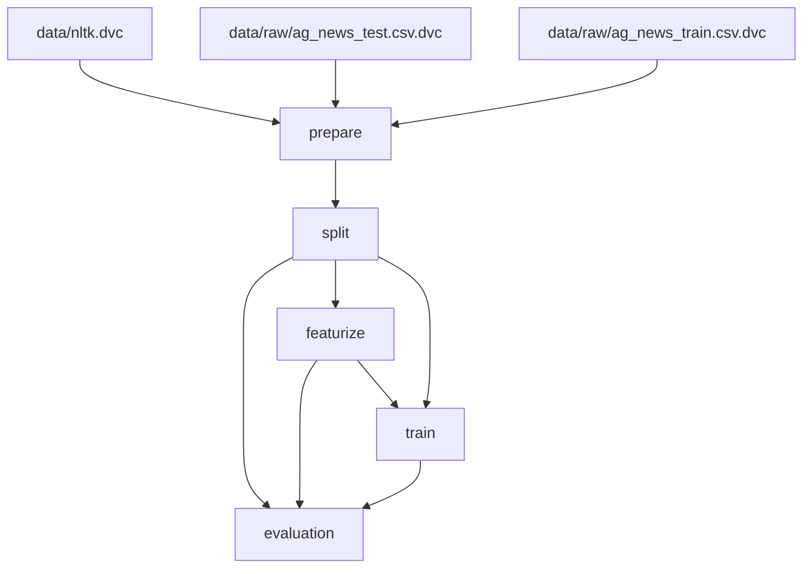

# Text classification
End-to-end MLOps Pipeline для классификации текстов с мониторингом дрейфа данных и автоматическим переобучением

# Setup
This project is based on `uv`. To setup project follow the instructions:
```bash
pip install uv
```
go to the project directory
```bash
uv sync
uv run python src/text_classification/__init__.py
```
Before starting the S3-compatible storage (RustFS) check `.env.example` file. It contains the necessary variables to run RustFS. Fill the `.env` file. 

To start S3-compatible storage use:
```bash
docker volume create s3data
docker compose up -d
```
Before using the dvc you **must** launch `gen_cred_file.py` to create local credentials for DVC access to S3:
```python
uv run python src/text_classification/gen_cred_file.py
```
Also there are `ruff` and `ty`. Usage:
```bash
uv run ruff check .             # lint
uv run ruff check --fix .       # lint and autofix (if possible)
uv run ruff format .            # format
uv run ruff format --check .    # format check (without format)

uv run ty check .               # type check
uv run ty check . --watch       # type check after editing
uv run ty check --error all     # all rules as errors
```

# DVC Pipeline

